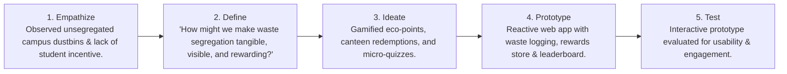
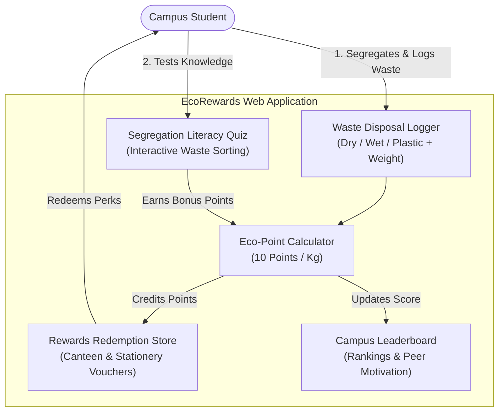

# EcoRewards — Campus Sustainability & Waste Segregation Platform

[](https://react.dev/)
[](https://vitejs.dev/)
[](https://developer.mozilla.org/en-US/docs/Web/JavaScript)
[](https://sdgs.un.org/goals/goal12)
[]()

A gamified web platform prototype developed for the **Design Thinking (DT)** Project-Based Learning (PBL) curriculum. It addresses campus waste mismanagement by transforming waste segregation into a rewarding, habit-forming experience through eco-points, canteen vouchers, and interactive awareness quizzes.

---

## 💡 The Design Thinking Journey



---

## 🏛️ Application Architecture & User Flow



---

## ✨ Core Features

1. **Smart Waste Logging**:
   * Three distinct disposal categories: **Dry** (paper/cardboard/metal), **Wet** (organic/food), and **Plastic** (bottles/packaging).
   * Weight-based calculation converting grams directly to earned eco-points.
   * Daily submission limits preventing fraudulent submissions.

2. **Gamified Rewards Store**:
   * Redeemable perks including campus canteen vouchers, free snacks/coffee, stationery packs, and bookstore credits.
   * Real-time stock tracking for available rewards.

3. **Waste Literacy Quiz**:
   * Interactive micro-quizzes testing knowledge on correct bin placement (e.g., electronic items, compostable packaging).
   * Instant feedback and educational explanations.

4. **Campus Leaderboard**:
   * Student rank tracking showcasing top eco-contributors across departments.
   * Fosters constructive social motivation and environmental accountability.

---

## 🚀 Running Locally

### Prerequisites
* **Node.js**: 18+ and `npm`

### Setup Steps

```bash
# Clone the repository
git clone https://github.com/shutkarshX/EcoRewards.git
cd EcoRewards

# Install project dependencies
npm install

# Start the Vite development server
npm run dev
```

*Open `http://localhost:5173` in your browser to interact with the application.*

### Production Build

```bash
# Compile optimized production bundle
npm run build

# Preview production build locally
npm run preview
```

---

## 📂 Repository Structure

```text
EcoRewards/
├── src/
│   ├── App.jsx                # Main gamified application (UI, Quiz, Store, Leaderboard)
│   ├── main.jsx               # React DOM root mounting
│   └── index.css              # Global styles & layout variables
├── index.html                 # HTML shell
├── vite.config.js             # Vite build configuration
├── package.json               # NPM scripts and dependencies
├── .gitignore
└── README.md
```

---

## 📜 Academic Curriculum Mapping
* **Subject:** Design Thinking (DT).
* **Focus Area:** Environmental Sustainability, Campus Waste Management, Behavior Design & Gamification, User-Centric Prototyping.
